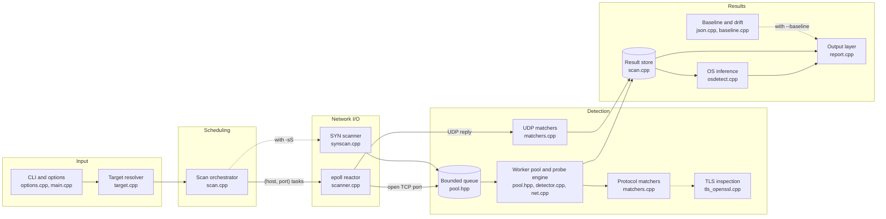

# Architecture

<!-- BEGIN GENERATED: docs/architecture.json (edit the JSON, then run scripts/gen_architecture.py) -->
**How a scan moves through Recon: one reactor thread owns the scan sockets, and a bounded worker pool does service detection.**

*Source: docs/ARCHITECTURE.md and src/ in recon 2.1.0.*

### Diagram

Dashed arrows are optional paths. Cylinders are data stores.

### Components by stage

#### Input

| Component | File | What it does | Notes |
|---|---|---|---|
| **CLI and options** | `options.cpp`, `main.cpp` | Parses flags, applies a scan profile (explicit flags always override it) and prints an authorization notice. | — |
| **Target resolver** | `target.cpp` | Expands IPv4, IPv6, hostnames and CIDR ranges (with a host cap). Targets from -iL files are read by the option parser and resolved the same way. | — |

#### Scheduling

| Component | File | What it does | Notes |
|---|---|---|---|
| **Scan orchestrator** | `scan.cpp` | Creates (host, port) tasks in port-major order and drives the chosen scan engine. | — |

#### Network I/O

| Component | File | What it does | Notes |
|---|---|---|---|
| **epoll reactor** | `scanner.cpp` | One thread multiplexes up to max-inflight non-blocking sockets. Handles connect completion, deadlines, retries, token-bucket rate limiting, back-off on fd exhaustion and cancellation. | • Serves both TCP connect and UDP scans. • Nothing else touches the scan sockets. |
| **SYN scanner** | `synscan.cpp` | Raw-socket half-open scan. Each probe uses a random sequence number and only replies acknowledging it are believed. | • IPv4 only; needs CAP_NET_RAW. • Does not parse ICMP unreachables, so blocked ports time out as filtered. |

#### Detection

| Component | File | What it does | Notes |
|---|---|---|---|
| **Bounded queue *(data store)*** | `pool.hpp` | Open TCP ports wait here for detection. Capacity is 4 x workers, so the producer blocks when it is full and memory stays bounded. | — |
| **Worker pool and probe engine** | `pool.hpp`, `detector.cpp`, `net.cpp` | Waits for a passive banner, then sends active probes ordered by port hint and rarity. Fresh connection per probe, hard time budget per port, first confident match wins. | — |
| **Protocol matchers** | `matchers.cpp` | Pure functions from bytes to an optional detection. Every offset goes through a bounds-checked reader; fuzzed under ASan and UBSan. | — |
| **TLS inspection** | `tls_openssl.cpp` | Optional certificate inspection, compiled only when OpenSSL is available. | — |
| **UDP matchers** | `matchers.cpp` | Parse DNS, NTP and NetBIOS replies received by the reactor. | — |

#### Results

| Component | File | What it does | Notes |
|---|---|---|---|
| **Result store *(data store)*** | `scan.cpp` | Mutex-guarded. Closed and filtered ports are counted, not stored, so a full-range scan does not allocate 65,535 records. | — |
| **OS inference** | `osdetect.cpp` | Aggregates evidence rather than fingerprinting. TTL-only evidence is capped at 40 to 50 percent confidence. | — |
| **Output layer** | `report.cpp` | Table, strict-UTF-8 JSON and CSV (with a formula-injection guard), plus the process exit code. | — |
| **Baseline and drift** | `json.cpp`, `baseline.cpp` | A strict, depth-limited JSON parser loads a previous report. Drift is computed only over hosts and ports the current scan covered; new open ports give exit code 5. | — |

### Flows

#### TCP scan with service detection

CLI and options → Target resolver → Scan orchestrator → epoll reactor → Bounded queue → Worker pool and probe engine → Result store → Output layer

1. **CLI and options** (`options.cpp, main.cpp`) — Parses flags, applies a scan profile (explicit flags always override it) and prints an authorization notice.
2. **Target resolver** (`target.cpp`) — Expands IPv4, IPv6, hostnames and CIDR ranges (with a host cap). Targets from -iL files are read by the option parser and resolved the same way.
3. **Scan orchestrator** (`scan.cpp`) — Creates (host, port) tasks in port-major order and drives the chosen scan engine.
4. **epoll reactor** (`scanner.cpp`) — One thread multiplexes up to max-inflight non-blocking sockets. Handles connect completion, deadlines, retries, token-bucket rate limiting, back-off on fd exhaustion and cancellation.
5. **Bounded queue** (`pool.hpp`) — Open TCP ports wait here for detection. Capacity is 4 x workers, so the producer blocks when it is full and memory stays bounded.
6. **Worker pool and probe engine** (`pool.hpp, detector.cpp, net.cpp`) — Waits for a passive banner, then sends active probes ordered by port hint and rarity. Fresh connection per probe, hard time budget per port, first confident match wins.
7. **Result store** (`scan.cpp`) — Mutex-guarded. Closed and filtered ports are counted, not stored, so a full-range scan does not allocate 65,535 records.
8. **Output layer** (`report.cpp`) — Table, strict-UTF-8 JSON and CSV (with a formula-injection guard), plus the process exit code.

#### SYN scan

CLI and options → Target resolver → Scan orchestrator → SYN scanner → Bounded queue → Worker pool and probe engine → Result store → Output layer

1. **CLI and options** (`options.cpp, main.cpp`) — Parses flags, applies a scan profile (explicit flags always override it) and prints an authorization notice.
2. **Target resolver** (`target.cpp`) — Expands IPv4, IPv6, hostnames and CIDR ranges (with a host cap). Targets from -iL files are read by the option parser and resolved the same way.
3. **Scan orchestrator** (`scan.cpp`) — Creates (host, port) tasks in port-major order and drives the chosen scan engine.
4. **SYN scanner** (`synscan.cpp`) — Raw-socket half-open scan. Each probe uses a random sequence number and only replies acknowledging it are believed.
5. **Bounded queue** (`pool.hpp`) — Open TCP ports wait here for detection. Capacity is 4 x workers, so the producer blocks when it is full and memory stays bounded.
6. **Worker pool and probe engine** (`pool.hpp, detector.cpp, net.cpp`) — Waits for a passive banner, then sends active probes ordered by port hint and rarity. Fresh connection per probe, hard time budget per port, first confident match wins.
7. **Result store** (`scan.cpp`) — Mutex-guarded. Closed and filtered ports are counted, not stored, so a full-range scan does not allocate 65,535 records.
8. **Output layer** (`report.cpp`) — Table, strict-UTF-8 JSON and CSV (with a formula-injection guard), plus the process exit code.

#### UDP scan

CLI and options → Target resolver → Scan orchestrator → epoll reactor → UDP matchers → Result store → Output layer

1. **CLI and options** (`options.cpp, main.cpp`) — Parses flags, applies a scan profile (explicit flags always override it) and prints an authorization notice.
2. **Target resolver** (`target.cpp`) — Expands IPv4, IPv6, hostnames and CIDR ranges (with a host cap). Targets from -iL files are read by the option parser and resolved the same way.
3. **Scan orchestrator** (`scan.cpp`) — Creates (host, port) tasks in port-major order and drives the chosen scan engine.
4. **epoll reactor** (`scanner.cpp`) — One thread multiplexes up to max-inflight non-blocking sockets. Handles connect completion, deadlines, retries, token-bucket rate limiting, back-off on fd exhaustion and cancellation.
5. **UDP matchers** (`matchers.cpp`) — Parse DNS, NTP and NetBIOS replies received by the reactor.
6. **Result store** (`scan.cpp`) — Mutex-guarded. Closed and filtered ports are counted, not stored, so a full-range scan does not allocate 65,535 records.
7. **Output layer** (`report.cpp`) — Table, strict-UTF-8 JSON and CSV (with a formula-injection guard), plus the process exit code.
<!-- END GENERATED -->

## Threading model and invariants

* The reactor thread owns all scan sockets; nothing else touches them.
* Detection workers never touch the reactor. They share only the result store, guarded by one mutex.
* The queue holds at most `4 × workers` ports, so memory stays bounded however many ports open; when it is full the scanner pauses (back-pressure).
* `CancelToken` is a lock-free atomic set from the signal handler; the reactor polls it at least every 100 ms, workers between probes.
* `connect()` success is checked with `getsockname == getpeername`: Linux can connect a socket to itself on loopback, which is not a listener.
* Closed and filtered ports are **counted, not stored**, so a 65,535-port scan does not allocate 65,535 records.
* Everything a remote host sends is untrusted: responses are size-capped, each probe and each port has a time budget, text fields are reduced to printable ASCII, and parsers are pure functions that never read past their input.
* Baseline files are untrusted too: the JSON parser limits nesting depth and total value count and validates UTF-8; malformed entries are skipped, never trusted.
* Reports are written through a single file descriptor created with mode `0600` and `O_NOFOLLOW`, so a symlink planted at the destination is refused.

## Confidence model

`confidence` (0-100) scores whether `service` is right, not the version:

| Range | Meaning | Examples |
|---|---|---|
| 90-100 | Response passed strict protocol validation | SSH identification string, MySQL handshake packet, TLS ServerHello |
| 50-89 | Partial or ambiguous evidence | `220` greeting with no product keyword on port 21; TLS alert; `tcpwrapped` |
| 1-49 | Guess | Service name taken from the port number |

`version_quality` is separate: `reported` (parsed from a protocol-defined field of a validated response; the service *claims* it), `inferred` (guess, never carries a version number), `none`.
Nothing a banner-grabber sees can *verify* a version, which is why the field is not called "verified".

## Keeping this document accurate

The diagram, component tables and flows above are generated from [`architecture.json`](architecture.json). To change them, edit the JSON and run
`python3 scripts/gen_architecture.py`. The generator refuses maps that name a source file that does not exist, reference an unknown component,
or describe a flow whose steps are not connected by declared edges, and `tests/doc_test.py` (run by CTest) fails if this file is stale.
